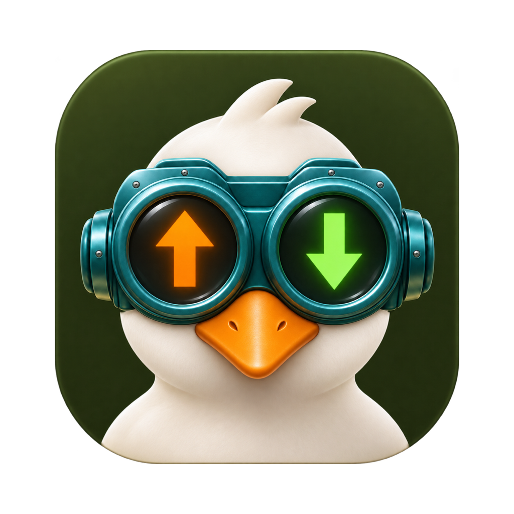

<p align="center"></p>

# Techno Goose

A native macOS file-transfer client written in Swift and SwiftUI, with a local folder and a server folder side by side.

**Protocols:** SFTP, FTP, FTPS, WebDAV (HTTP/HTTPS) and local disk.

**Website:** [gerbenhoogendam.github.io/technogoose](https://gerbenhoogendam.github.io/technogoose/) (source in `docs/`).

## Download

**[Download Techno Goose for Mac](https://github.com/gerbenhoogendam/technogoose/releases/latest)**: a universal app for Apple silicon and Intel Macs with macOS 14 or later, signed and notarised by Apple. Unzip it and move Techno Goose to your Applications folder.

## Features

- **Up to four browsers:** each pane shows your Mac or any server. Drag the dividers to resize, drag a pane's ≡ grip to move it, and drag files between panes or in from Finder. With two panes, View › Two Panes Top and Bottom (⌥⌘D) stacks them.
- **Sync between any two neighbouring panes:** pick To right, To left or Both ways in the strip between the panes, then Preview Sync. The preview compares both folders file by file: what differs, what exists on one side only and (if you want) what is the same, with size and date on each side. Every file shows what happens to it, and you can send it the other way or leave it alone, per file or for a selection. Nothing moves until you click Sync there.
- **Open folders by dragging:** drop a folder from Finder on a pane's header to open it there; drop two to open them side by side and compare them. Also from Finder › Services › Open in Techno Goose, or `open -a "Techno Goose" folder1 folder2` in Terminal. Dropping on the file list still copies into that folder.
- **See what changes inside a file:** in the preview, Space or double-click opens a comparison of the file that arrives against the one it replaces. Text (HTML, CSS, JS, PHP, JSON, SVG, XML, Markdown, CSV and so on, minified or not) shows the changed lines and words; images (JPEG, PNG, GIF, WebP, AVIF, HEIC, ICO, BMP, TIFF) and PDF pages get a pixel diff in magenta; a PDF's text is compared page by page; fonts show their names and a sample line; video and audio show length, size, a frame or a waveform; ZIP and TAR archives list what's inside. Anything else is compared byte by byte.
- **Sync rules:** what counts as changed (size, or size and date) and which version wins: replace, only when newer, or only add new files; for both ways the newest, the left, the right or neither. A file that only has a newer date is checked byte for byte first, so identical files are left alone.
- **Copy across:** select files and click Copy in the strip between the panes, or drag them. A copy that would replace files shows the same preview first.
- **Undo:** files that get replaced are backed up first, so any sync or copy can be rolled back: Undo in the status bar, Edit › Undo (⌘Z), or the Transfers and Timeline panel. A sync never deletes anything.
- **Timeline per connection:** uploads, downloads, syncs, deletes and undos, grouped by day.
- **Folder sizes:** every folder's total size is worked out in the background.
- **Hidden files:** View › Show Hidden Files (⇧⌘.).
- **Themes:** View › Theme › Nova Midnight, Nova Daylight or Neon Pond, after Panic's Nova editor, Macintosh 512K in greyscale and Chicago, or Label Lime: near-black, square corners and chartreuse, with paths and numbers in Bebas Neue.
- **Settings (⌘,):** theme, one of ten goose icons for the Dock, hidden files, folder sizes on or off, whether Activity opens when a transfer starts, a sound when a sync finishes, how many syncs can be undone (and clearing those backups), and iCloud bookmarks.
- **Excludes:** per bookmark, e.g. `node_modules, .git, *.log`.
- **Folder pairs and auto-upload:** each bookmark remembers its local and server folders, and can upload changes as soon as you save.
- **Favorites:** any folder, on your Mac or a server, can be pinned in the sidebar.
- **Start folder:** right-click a server folder › Set as Start Folder.
- **One-click backup:** back up a server into a folder you choose, as dated snapshots. Unchanged files are APFS clones of the previous snapshot, so only changes are downloaded.
- **Bookmarks in iCloud Drive:** Bookmarks › Sync Bookmarks with iCloud Drive, with a daily backup you can restore. Passwords stay in each Mac's Keychain.
- **Import from Cyberduck:** Bookmarks › Import from Cyberduck… brings in its SFTP, FTP, FTPS and WebDAV bookmarks. Importing twice adds nothing new; passwords are asked on first connect.
- **Edit in your own app:** open a server file in its default app; every save is uploaded back to the server.

Passwords are stored in the macOS Keychain. SFTP uses the system `sftp` (your SSH keys work), and FTP/FTPS use the system `curl`.

## Build

Requires macOS 14 or later and Swift 5.9 or later.

```sh
./build-app.sh                       # builds Techno Goose.app
NOTARY_PROFILE=<profile> ./release.sh  # universal, signed and notarised: TechnoGoose-<version>.zip
.build/release/Technoduck --self-test
```

`Cargo.toml` and `launcher/` only exist so a Cargo-based checker can build and start the Swift app. You don't need them.

## License

MIT — see [LICENSE](LICENSE). The ChicagoFLF font by Robin Casady is in the public domain; see [Resources/README.ChicagoFLF](Resources/README.ChicagoFLF). Bebas Neue by Dharma Type is under the SIL Open Font License; see [Resources/OFL.BebasNeue.txt](Resources/OFL.BebasNeue.txt).
